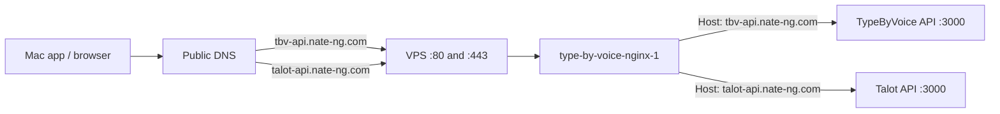
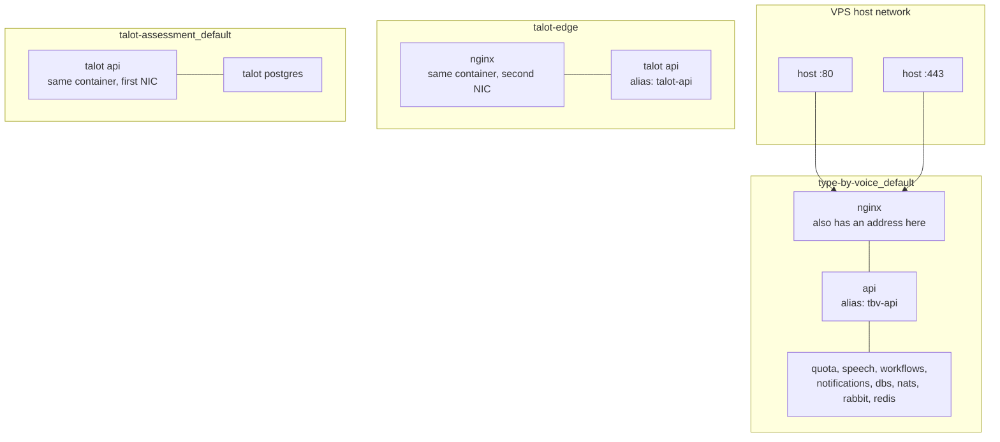
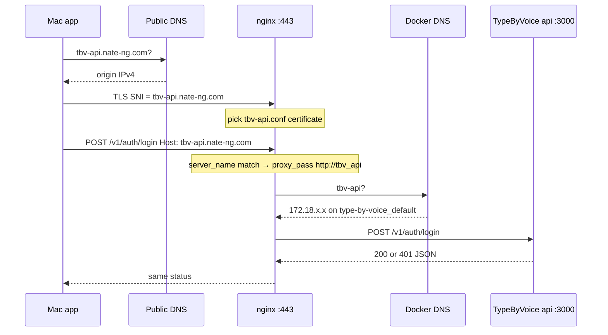
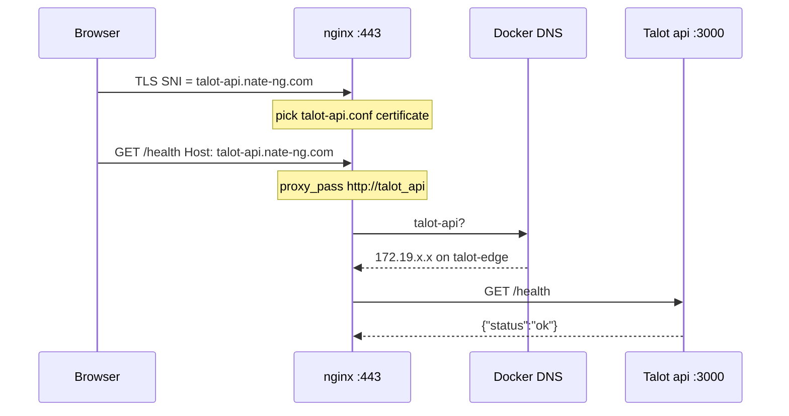
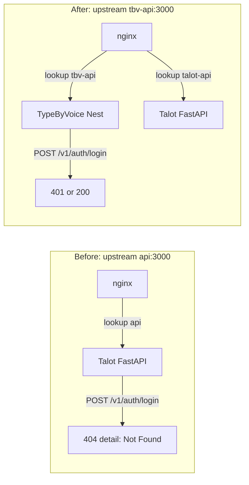

# Shared Nginx edge on one VPS

How TypeByVoice and Talot share one public Nginx, what the Docker networks are for, and how a request is routed to the right app.

This is the layout that was live on the production host after Talot was attached to the existing TypeByVoice edge.
IPs below are examples.
Docker assigns them again whenever a container is recreated.

---

## 1. Three questions people mix together

Sharing Nginx is three independent lookups, not one:

| Question | Answered by | Example |
|---|---|---|
| Who owns ports 80 and 443 on the VPS? | Linux: only one process can bind a given port | `type-by-voice-nginx-1` via `ports: ["80:80", "443:443"]` |
| Which *site* is this TCP connection for? | Nginx `server_name` plus TLS SNI / HTTP `Host` | `tbv-api.nate-ng.com` vs `talot-api.nate-ng.com` |
| Which *container* should receive the HTTP request? | Docker DNS names in `upstream { server ... }` | `tbv-api:3000` vs `talot-api:3000` |

If you remember only one thing: **hostname picks the site, Docker DNS picks the container, and they are not the same name.**
`tbv-api.nate-ng.com` is a public DNS name on the internet.
`tbv-api` is a private name that only exists inside Docker.

---

## 2. Why there is only one Nginx

The kernel will not let two processes listen on `0.0.0.0:443` at once.
TypeByVoice's Compose file publishes those ports:

```yaml
nginx:
  ports:
    - "80:80"
    - "443:443"
```

Talot's production Compose file publishes **no** 80/443.
Its API is reachable only on an internal Docker network.
The TypeByVoice Nginx container is the single public door.

That is the whole reason for a shared edge: one TLS terminator, many backends.



Both public names currently resolve to the same origin IPv4.
Nginx is what splits them.

---

## 3. Docker networks: isolation plus one bridge

A Compose project gets a private bridge named `{project}_default`.
Containers on that bridge can resolve each other by **service name**.
Containers on different bridges cannot talk unless they share a third network.

There are three user-defined bridges on this host:

```text
type-by-voice_default     TypeByVoice family only
talot-assessment_default  Talot family only
talot-edge                the shared bridge: Nginx + Talot API
```



Read that as one Nginx process with **two network interfaces**:

- On `type-by-voice_default` it can reach TypeByVoice's API, and nothing Talot-side except through the other NIC.
- On `talot-edge` it can reach Talot's API.
- Talot's Postgres stays on `talot-assessment_default`.
  Nginx never needs it.
- TypeByVoice's NATS / Rabbit / Redis stay on `type-by-voice_default`.
  Talot never needs them.

Nginx is the only TypeByVoice service that joins `talot-edge`.
That join is **not** in git.
Talot's `edge-init.sh` writes `/opt/type-by-voice/deploy/docker-compose.override.yml` on the host:

```yaml
services:
  nginx:
    networks:
      - default
      - talot-edge

networks:
  talot-edge:
    external: true
```

`docker compose` merges that file with `docker-compose.yml` automatically.
`external: true` means "this network already exists; do not create or delete it with this project."

---

## 4. How Nginx chooses the app

`nginx.conf` includes every file in `conf.d/`:

```text
include /etc/nginx/conf.d/*.conf;
```

On the host that directory currently has two live site files (plus examples):

| File | `server_name` | `proxy_pass` |
|---|---|---|
| `tbv-api.conf` | `tbv-api.nate-ng.com` | `http://tbv_api` → `tbv-api:3000` |
| `talot-api.conf` | `talot-api.nate-ng.com` | `http://talot_api` → `talot-api:3000` |

`talot-api.conf` is also **not** in this git repo.
Talot's deploy copies it here so the already-running Nginx process learns the second site.

### TLS SNI, then HTTP Host

1. The client opens TCP to the VPS on 443.
2. TLS starts.
   The client sends **SNI** (Server Name Indication): the hostname it thinks it is talking to.
3. Nginx picks the `server { listen 443 ssl; server_name ... }` block whose `server_name` matches SNI, and uses that block's certificate.
4. After TLS, the HTTP request has a `Host` header.
   Nginx matches `server_name` again (normally the same hostname).
5. Inside that server, `location` picks `/` vs `/v1/dictate` vs ACME.
6. `proxy_pass http://tbv_api` (or `talot_api`) sends the request to the upstream.

Path is **not** how the two apps are distinguished.
`/v1/auth/login` on `tbv-api.nate-ng.com` is TypeByVoice.
`/v1/auth/login` on `talot-api.nate-ng.com` is Talot (and Talot does not have that route).

### Default server

`include conf.d/*.conf` loads files in **alphabetical** order.
`talot-api.conf` sorts before `tbv-api.conf`.
The first `listen 443 ssl` becomes Nginx's default TLS server.

A client that connects to `https://116.118.9.222` with no matching SNI/Host lands on Talot, not TypeByVoice.
Public clients should always use the hostnames.

---

## 5. How Nginx finds the container (Docker DNS)

`proxy_pass http://tbv_api` does not talk to the public internet.
`tbv_api` is an Nginx **upstream** whose `server` line is a Docker DNS name:

```nginx
upstream tbv_api {
  server tbv-api:3000;
}

upstream talot_api {
  server talot-api:3000;
}
```

Docker's embedded DNS (`127.0.0.11` inside the container) answers those names from the networks the Nginx container is on.

| Name Nginx looks up | Network where it exists | Container it should hit |
|---|---|---|
| `tbv-api` | `type-by-voice_default` (Compose alias on the `api` service) | TypeByVoice Nest API |
| `talot-api` | `talot-edge` (Compose alias on Talot's `api` service) | Talot FastAPI |

TypeByVoice's API does not join `talot-edge`.
It does not need to.
Nginx already shares `type-by-voice_default` with it.

Nginx resolves upstream hostnames **when it loads or reloads config**, not on every request.
After recreating the API container (new IP), Nginx must be reloaded.
`deploy/scripts/deploy.sh` does that on purpose.

---

## 6. A request, hop by hop

### TypeByVoice login from the Mac app

The packaged app has `TBV_API_URL=https://tbv-api.nate-ng.com` in `Info.plist`.
Sign-in POSTs `/v1/auth/login`.



Health for this hostname is Nest Terminus JSON: it includes `info` / `details` for the database, not only `{"status":"ok"}`.

### Talot health from a browser

Same public IP, different hostname.



Talot never receives TypeByVoice's `/v1/dictate` WebSocket, because that `location` lives only in `tbv-api.conf`.

---

## 7. The `api` name collision (the 404)

Compose always registers the **service name** as a DNS name on every network the container joins.
Talot's service is also called `api`.
That name is therefore present on `talot-edge`.

Nginx sits on `talot-edge` **and** `type-by-voice_default`.
When it asked Docker for the short name `api`, the answer was Talot's address on `talot-edge`, not TypeByVoice.

```text
# from inside type-by-voice-nginx-1, before the fix
getent hosts api                 →  172.19.0.2   Talot
getent hosts talot-api           →  172.19.0.2   Talot (same box, intended alias)
getent hosts type-by-voice-api-1 →  172.18.0.10  TypeByVoice
```

`tbv-api.conf` used to say `server api:3000`.
Every public TypeByVoice URL, including `/v1/auth/login`, was proxied to Talot.
Talot is FastAPI.
Unknown routes return `{"detail":"Not Found"}`.
The Mac app surfaces that as `Request failed (HTTP 404).`

`/health` still looked "fine" because both apps implement `/health` and both return JSON containing `"status":"ok"`.
The difference is that TypeByVoice's body is the longer Terminus payload.

The fix is a **unique** alias that only TypeByVoice owns, plus an upstream that uses it:

```yaml
# deploy/docker-compose.yml  (api service)
networks:
  default:
    aliases:
      - tbv-api
```

```nginx
upstream tbv_api {
  server tbv-api:3000;
}
```

`api` still resolves to Talot from Nginx.
Nothing should use that short name from a container that is also on `talot-edge`.



---

## 8. What lives in git vs only on the host

| Path on the VPS | In this repo? | Role |
|---|---|---|
| `deploy/docker-compose.yml` | yes | TypeByVoice stack, including `tbv-api` alias |
| `deploy/nginx/conf.d/tbv-api.conf` | yes | TypeByVoice site |
| `deploy/docker-compose.override.yml` | **no** (Talot writes it) | attaches Nginx to `talot-edge` |
| `deploy/nginx/conf.d/talot-api.conf` | **no** (Talot writes it) | Talot site |
| Docker network `talot-edge` | **no** | created by Talot `edge-init.sh` |

A TypeByVoice deploy that `git pull`s will not delete those untracked files.
It can recreate the Nginx container.
The override file is why the new Nginx still joins `talot-edge`.

Do not add a second Compose Nginx that also publishes 80/443.
That fight is what "Nginx cannot share" usually means, and it is a port bind, not a hostname limit.

---

## 9. Inspect it yourself

On the host:

```bash
docker network ls
docker inspect type-by-voice-nginx-1 --format '{{json .NetworkSettings.Networks}}'
docker exec type-by-voice-nginx-1 getent hosts tbv-api
docker exec type-by-voice-nginx-1 getent hosts talot-api
docker exec type-by-voice-nginx-1 getent hosts api
```

From a laptop:

```bash
curl -sS https://tbv-api.nate-ng.com/health
# Nest Terminus: status plus info/details

curl -sS https://talot-api.nate-ng.com/health
# FastAPI: {"status":"ok"}

curl -sS -o /dev/null -w '%{http_code}\n' \
  -H 'content-type: application/json' \
  -d '{"email":"x@example.com","password":"password12","platform":"macos","clientVersion":"1.0.0","deviceId":"9c1e4a2b-7d55-4f3a-9e10-2b8c0d1a4f77"}' \
  https://tbv-api.nate-ng.com/v1/auth/login
# 401 means the TypeByVoice route exists. 404 with {"detail":"Not Found"} means Nginx is still on Talot.
```

---

## 10. Related docs

- [`deploy/README.md`](../deploy/README.md) — bootstrap, TLS, GitHub Actions deploy.
- [`docs/rate-limiting-client-ip.md`](./rate-limiting-client-ip.md) — how Nginx decides the caller IP after Cloudflare vs a direct connection.
- Talot's `deploy/README.md` on the host (`/opt/talot-assessment/deploy/README.md`) — `edge-init.sh`, `talot-edge`, and the Talot site file.
